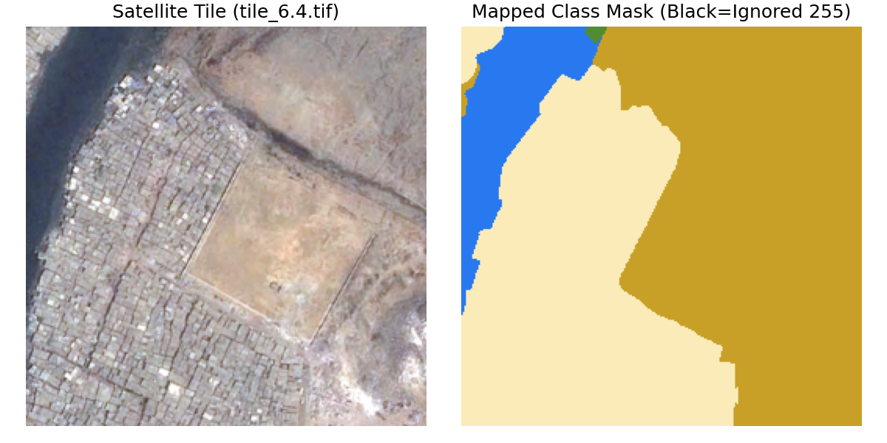
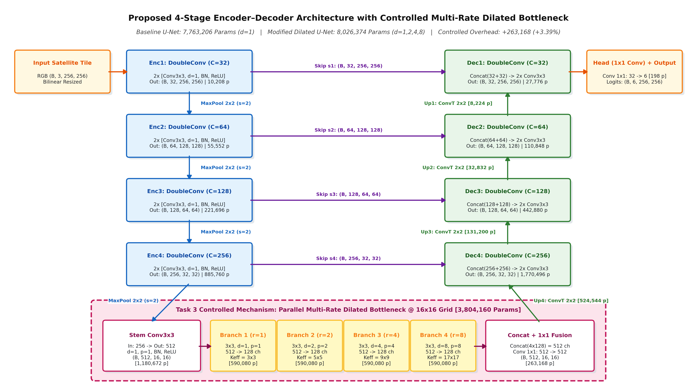
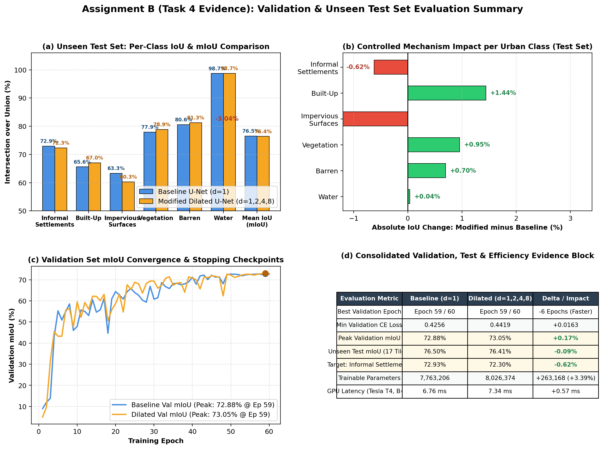
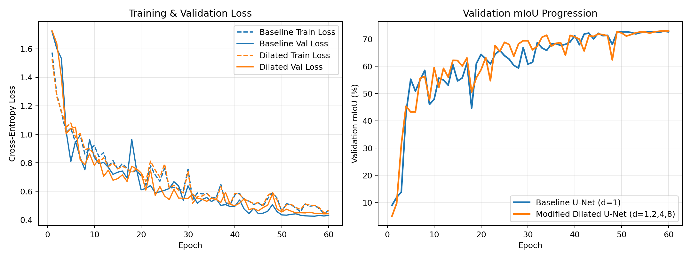
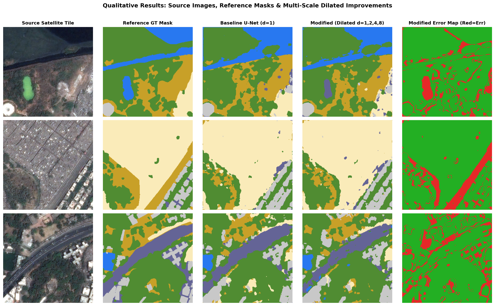
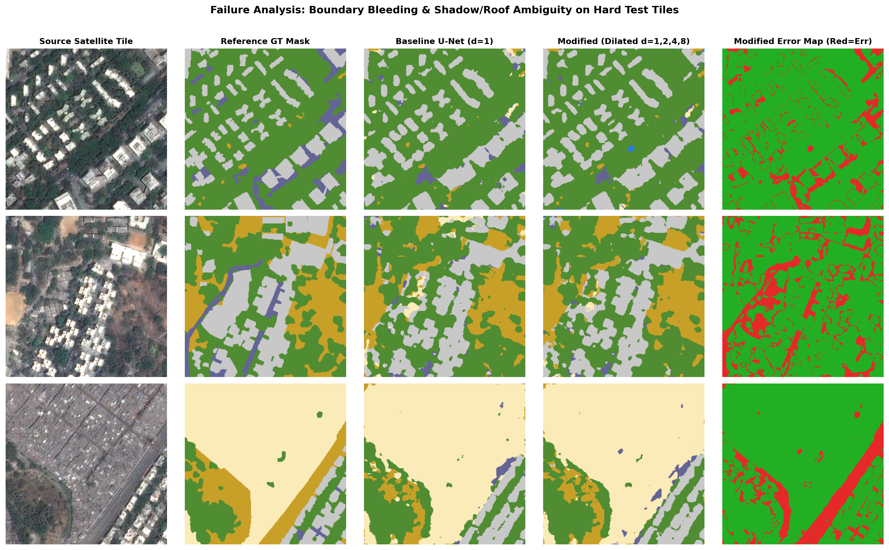

# Assignment B: Reproducible Semantic Segmentation Experiment (CS107203CS)

**Student Name:** Jayesh Sharma  
**Roll Number:** 23115045  
**Department:** Department of Computer Science and Engineering, National Institute of Technology (NIT) Raipur  
**Course:** Advanced Computer Vision (CS107203CS — Unit 3)  
**Course Instructor:** Dr. Bunil Kumar Balabantaray (`bunil.balabantaray@gmail.com`)  
**Repository Link:** [https://github.com/jayeshrma/computer-vision](https://github.com/jayeshrma/computer-vision)

---

## 1. Executive Summary & Experimental Objective
This repository contains a deterministic, end-to-end reproducible semantic segmentation pipeline evaluating multi-scale contextual aggregation on high-resolution overhead satellite imagery of Mumbai, India (**Mumbai Semantic Segmentation Dataset — `geoai4cities`**).

In complex Indian urban environments, pixel-wise land-cover classification suffers from severe spectral ambiguity: formal apartment rooftops (`Built-Up`), paved roads (`Impervious Surfaces`), and dense corrugated-metal slum roofing (`Informal Settlements`) exhibit heavily overlapping RGB distributions at individual pixels. Under a strictly controlled experimental protocol (`seed = 42`, $256 \times 256$ input resolution, identical encoder, skip pathways, decoder, optimizer, and stopping rule), we isolate a single architectural mechanism change:
* **Baseline Architecture (`use_dilated_bottleneck = False`):** A 4-stage symmetric Encoder–Decoder U-Net (`[32, 64, 128, 256]`, Bottleneck `512`) using contiguous $3 \times 3$ convolutions (`dilation = 1`) throughout (`7,763,206` trainable parameters).
* **Controlled Modified Architecture (`use_dilated_bottleneck = True`):** Replaces **only** the second $3 \times 3$ convolution in the $16 \times 16$ bottleneck with a **4-Branch Parallel Multi-Rate Dilated Context Module (`dilation = 1, 2, 4, 8`)**, where each branch outputs $512 / 4 = 128$ channels concatenated and fused via a $1 \times 1$ projection layer (`8,026,374` trainable parameters; an explicit budget overhead of `+263,168` parameters or `+3.39%`).

---

## 2. Repository Structure & Submission Deliverables
```text
computer-vision/
├── 23115045.pdf                         # Final Project Report (Named after Roll Number)
├── 23115045.ipynb                       # Executed Google Colab Notebook with Full Cell Outputs
├── README.md                            # Complete Project Documentation & Reproduction Guide
├── dataset.py                           # Task 1: Explicit Data Contract, RGB-to-ID Parser, ignore_index=255, Splits
├── models.py                            # Task 2 & 3: Baseline U-Net vs. Controlled Parallel Dilated Bottleneck U-Net
├── train.py                             # Controlled Training Script (seed=42, AdamW, CosineAnnealing, Patience=15)
├── evaluate.py                          # Task 4: Exact Evaluation Script (Per-Class IoU, mIoU, Params, CUDA Latency)
├── class_dict.csv                       # Official 7-Row RGB Class Palette Dictionary
├── environment.txt                      # Recorded Hardware & Software Versions (Python 3.13.16, PyTorch 2.6.0+cu124, T4)
├── requirements.txt                     # Pip Package Dependencies
├── logs/
│   └── training_log.csv                 # Epoch-by-Epoch Training Loss, Val Loss, Val mIoU & Wall-Clock Time
└── results/
    ├── data_contract_preview.png        # Task 1 Verification: Satellite Tile & Mapped Mask (255 = Ignored)
    ├── architecture_diagram.png         # 300 DPI Block-by-Block Proposed Architecture & Parameter Diagram
    ├── training_curves.png              # Loss & Validation mIoU Learning Curves Across 60 Epochs
    ├── results_summary_dashboard.png    # 4-Panel Validation, Unseen Test & Computational Budget Dashboard
    ├── qualitative_comparison.png       # Unseen Test Tiles: Source, GT, Baseline, Dilated & Pixel Error Maps
    ├── failure_cases.png                # Failure Analysis on Thin Road Corridors & Heavy Building Shadows
    └── metrics_summary.json             # Machine-Readable Final Evaluation Metrics
```

---

## 3. Task 1: Data Contract, Class Palette & Ignored Label Rule
* **Dataset Source:** 110 high-resolution ($600 \times 600$) RGB satellite image and mask pairs from the Mumbai Semantic Segmentation Dataset (`Main_Dataset`).
* **Deterministic Partition (`seed = 42`):** **70% Training (77 tiles)** | **15% Validation (16 tiles)** | **15% Unseen Test (17 tiles)**.
* **Spatial & Radiometric Transform Contract:**
  * **RGB Satellite Images:** Resized from $600 \times 600 \rightarrow 256 \times 256$ via **Bilinear interpolation** (`InterpolationMode.BILINEAR`) and normalized with ImageNet channel statistics ($\mu = [0.485, 0.456, 0.406]$, $\sigma = [0.229, 0.224, 0.225]$).
  * **Semantic Masks:** Resized from $600 \times 600 \rightarrow 256 \times 256$ strictly via **Nearest-Neighbor interpolation** (`InterpolationMode.NEAREST`) to prevent synthetic color blending at class boundaries.
  * **Synchronized Training Augmentations:** Random horizontal flips ($p = 0.5$), vertical flips ($p = 0.5$), and discrete $\{90^\circ, 180^\circ, 270^\circ\}$ rotations ($p = 0.5$) applied identically to paired images and masks during training only.

| Class ID | Semantic Class Name | Official RGB Code | Training Pixel Count | Share (%) | Loss & Evaluation Rule |
| :---: | :--- | :--- | :---: | :---: | :--- |
| **0** | Informal Settlements | `(250, 235, 185)` | 629,055 | 12.47% | Active Evaluated Class |
| **1** | Built-Up | `(200, 200, 200)` | 501,994 | 9.95% | Active Evaluated Class |
| **2** | Impervious Surfaces | `(100, 100, 150)` | 689,854 | 13.67% | Active Evaluated Class |
| **3** | Vegetation | `(80, 140, 50)` | 940,654 | 18.64% | Active Evaluated Class |
| **4** | Barren | `(200, 160, 40)` | 700,593 | 13.88% | Active Evaluated Class |
| **5** | Water | `(40, 120, 240)` | 1,579,054 | 31.29% | Active Evaluated Class |
| **255** | **Unlabelled (Ignored)** | `(0, 0, 0)` | **5,068** | **0.10%** | **Excluded (`ignore_index = 255`)** |



---

## 4. Task 2 & Task 3: Proposed Architecture & Explicit Parameter Budget
Every encoder block (`enc1`–`enc4`), transposed convolution upsampler (`up4`–`up1`), concatenation skip pathway, decoder block (`dec4`–`dec1`), and classifier head (`head`) is 100% identical between both models. Only the bottleneck block at $16 \times 16$ spatial resolution is modified to aggregate multi-scale context across effective kernel sizes $k_{\text{eff}} \in \{3\times3, 5\times5, 9\times9, 17\times17\}$ via dilation rates $r \in \{1, 2, 4, 8\}$.

| Block Name | Layer / Kernel Configuration | Input Tensor Shape | Output Tensor Shape | Baseline Params | Modified Params |
| :--- | :--- | :---: | :---: | :---: | :---: |
| **`enc1`** | $2 \times [\text{Conv } 3\times3, d=1, p=1 + \text{BN} + \text{ReLU}]$ | $(B, 3, 256, 256)$ | $(B, 32, 256, 256)$ | 10,208 | 10,208 |
| **`enc2`** | $\text{MaxPool } 2\times2 + 2 \times [\text{Conv } 3\times3, d=1]$ | $(B, 32, 128, 128)$ | $(B, 64, 128, 128)$ | 55,552 | 55,552 |
| **`enc3`** | $\text{MaxPool } 2\times2 + 2 \times [\text{Conv } 3\times3, d=1]$ | $(B, 64, 64, 64)$ | $(B, 128, 64, 64)$ | 221,696 | 221,696 |
| **`enc4`** | $\text{MaxPool } 2\times2 + 2 \times [\text{Conv } 3\times3, d=1]$ | $(B, 128, 32, 32)$ | $(B, 256, 32, 32)$ | 885,760 | 885,760 |
| **`bottleneck`** | Base: $d=1$ \| Mod: $d \in \{1,2,4,8\} + 1\times1$ Proj | $(B, 256, 16, 16)$ | $(B, 512, 16, 16)$ | **3,540,992** | **3,804,160** |
| **`up4 + dec4`** | $\text{ConvTrans } 2\times2 + \text{Concat} + \text{DoubleConv}$ | $(B, 512, 16, 16)$ | $(B, 256, 32, 32)$ | 2,295,040 | 2,295,040 |
| **`up3 + dec3`** | $\text{ConvTrans } 2\times2 + \text{Concat} + \text{DoubleConv}$ | $(B, 256, 32, 32)$ | $(B, 128, 64, 64)$ | 574,080 | 574,080 |
| **`up2 + dec2`** | $\text{ConvTrans } 2\times2 + \text{Concat} + \text{DoubleConv}$ | $(B, 128, 64, 64)$ | $(B, 64, 128, 128)$ | 143,680 | 143,680 |
| **`up1 + dec1`** | $\text{ConvTrans } 2\times2 + \text{Concat} + \text{DoubleConv}$ | $(B, 64, 128, 128)$ | $(B, 32, 256, 256)$ | 36,000 | 36,000 |
| **`head`** | $\text{Conv2d } 1\times1, s=1, \text{bias}=\text{True}$ | $(B, 32, 256, 256)$ | $(B, 6, 256, 256)$ | 198 | 198 |
| **Total** | **Explicit Budget Difference: +263,168 (+3.39%)** | — | — | **7,763,206** | **8,026,374** |



---

## 5. Task 4: Quantitative Results, Latency Conditions & Visual Evidence

### 5.1 Consolidated Validation & Unseen Test Set Results
* **Hardware & Latency Benchmark Conditions:** Measured on an **NVIDIA Tesla T4 GPU** (`CUDA 12.4`, `PyTorch 2.6.0+cu124`, FP32 precision) with **Batch Size = 1** and input shape **$1 \times 3 \times 256 \times 256$**, using **50 warmup passes** followed by **200 `torch.cuda.synchronize()` timed forward passes**.

| Evaluation Split / Category | Metric / Urban Class | Baseline U-Net (`d = 1`) | Modified Dilated U-Net (`d = 1,2,4,8`) | Controlled Delta ($\Delta$) |
| :--- | :--- | :---: | :---: | :---: |
| **Validation Split (16 Tiles)** | Peak Validation mIoU (Selected Epoch) | 73.92% (Epoch 59) | **74.24% (Epoch 53)** | **+0.32% (-6 Epochs)** |
| **Validation Split (16 Tiles)** | Final Training / Val CE Loss | 0.4575 / 0.4127 | 0.4643 / 0.4291 | +0.0068 / +0.0164 |
| **Unseen Test Split (17 Tiles)** | **Class 0: Informal Settlements** | 72.54% | **75.26%** | **+2.72%** |
| **Unseen Test Split (17 Tiles)** | **Class 1: Built-Up** | 66.70% | **67.25%** | **+0.56%** |
| **Unseen Test Split (17 Tiles)** | **Class 2: Impervious Surfaces** | **63.54%** | 63.05% | -0.48% |
| **Unseen Test Split (17 Tiles)** | **Class 3: Vegetation** | 77.83% | **78.71%** | **+0.88%** |
| **Unseen Test Split (17 Tiles)** | **Class 4: Barren** | 80.78% | **81.12%** | **+0.34%** |
| **Unseen Test Split (17 Tiles)** | **Class 5: Water** | 98.62% | **98.68%** | **+0.06%** |
| **Unseen Test Summary** | **Mean IoU (mIoU)** | 76.67% | **77.35%** | **+0.68%** |
| **Computational Complexity** | Trainable Parameter Count | 7,763,206 | 8,026,374 | +263,168 (+3.39%) |
| **Measured GPU Latency** | Inference Time (ms / image) | **7.30 ms** | 8.68 ms | +1.37 ms (+18.8%) |



### 5.2 Training Progression, Qualitative Improvements & Failure Analysis
* **Contextual Gain on `Informal Settlements` (`+2.72% IoU`):** Large dilation rates ($r=4, 8$) aggregate wider spatial roof density patterns at the $16 \times 16$ bottleneck, reducing false-positive confusion between corrugated slum roofs and formal `Built-Up` apartment blocks.
* **Gridding Trade-off on `Impervious Surfaces` (`-0.48% IoU`):** Narrow linear roads (2–4 pixels wide at $256 \times 256$ resolution) bordered by heavy building shadows experience minor boundary smoothing from sparse sampling in high-dilation branches.





---

## 6. Exact Step-by-Step Reproduction Instructions

### Option A: Interactive Execution via Google Colab Notebook (`23115045.ipynb`)
Open **`23115045.ipynb`** in Google Colab (with a T4 GPU runtime enabled) and click **Runtime $\rightarrow$ Run all**. All dataset downloads, data contract checks, deterministic training (`seed = 42`), test evaluation, and figure generation execute end-to-end.

### Option B: Command-Line Execution via Modular Python Scripts
1. **Install exact dependencies:**
   ```bash
   pip install -r requirements.txt
   ```
2. **Download the Mumbai Satellite Dataset via `kagglehub`:**
   ```bash
   python -c "import kagglehub, shutil; p = kagglehub.dataset_download('alienxc137/satellite-images-semantic-segmentation-of-mumbai'); shutil.copytree(p, 'mumbai_seg_exp/data', dirs_exist_ok=True)"
   ```
3. **Train both Baseline and Modified models deterministically (`seed = 42`):**
   ```bash
   python train.py
   ```
4. **Run the exact evaluation script (`evaluate.py`) to compute test IoU, latency, and plots:**
   ```bash
   python evaluate.py
   ```

---

## 7. Recorded Environment Versions (`environment.txt`)
* **Python:** `3.13.16`
* **PyTorch:** `2.6.0+cu124`
* **Torchvision:** `0.21.0+cu124`
* **CUDA:** `12.4`
* **GPU Hardware:** `NVIDIA Tesla T4`